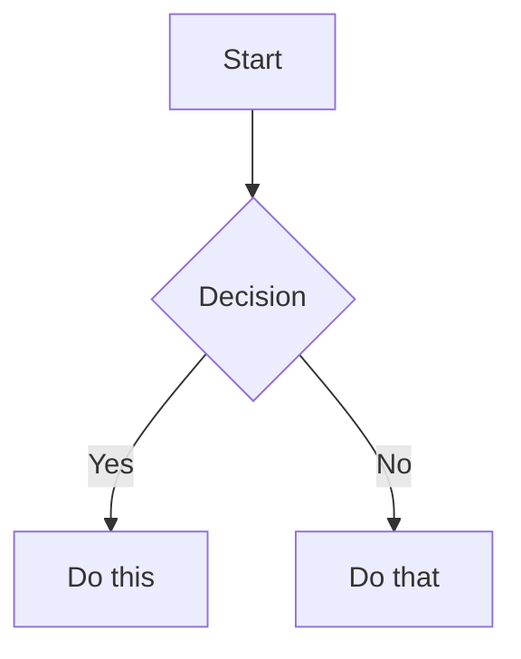

# Obsidian Flavored Markdown Reference

Use this for Obsidian-specific Markdown. Standard Markdown/GFM is assumed.

## Note Creation Workflow

1. Add frontmatter properties at top (`title`, `tags`, `aliases`, etc.).
2. Write content with standard Markdown plus Obsidian syntax below.
3. Use `[[wikilinks]]` for internal Vault notes; use `[text](url)` only for external URLs.
4. Use `![[embed]]` for embedded notes, images, PDFs, sections, or blocks.
5. Use callouts for highlighted information.
6. Verify rendering in Obsidian reading view when possible.

## Wikilinks

```markdown
[[Note Name]]
[[Note Name|Display Text]]
[[Note Name#Heading]]
[[Note Name#^block-id]]
[[#Heading in same note]]
```

Block IDs:

```markdown
This paragraph can be linked to. ^my-block-id

> A quote block

^quote-id
```

## Embeds

```markdown
![[Note Name]]
![[Note Name#Heading]]
![[image.png]]
![[image.png|300]]
![[document.pdf#page=3]]
```

## Callouts

```markdown
> [!note]
> Basic callout.

> [!warning] Custom Title
> Callout with custom title.

> [!faq]- Collapsed by default
> Foldable callout; `-` collapsed, `+` expanded.
```

Common types: `note`, `tip`, `warning`, `info`, `example`, `quote`, `bug`, `danger`, `success`, `failure`, `question`, `abstract`, `todo`.

## Properties

```yaml
---
title: My Note
date: 2024-01-15
tags:
  - project
  - active
aliases:
  - Alternative Name
cssclasses:
  - custom-class
---
```

Default properties: `tags`, `aliases`, `cssclasses`. Follow target Vault title/filename rules from the main Obsidian skill.

## Tags

```markdown
#tag
#nested/tag
```

Tags may also appear in frontmatter. Tags can contain letters, numbers not as first character, underscores, hyphens, and `/`.

## Other Syntax

Comments:

```markdown
This is visible %%hidden%% text.

%%
Hidden block.
%%
```

Highlight:

```markdown
==Highlighted text==
```

Math:

```markdown
Inline: $e^{i\pi} + 1 = 0$

$$
\frac{a}{b} = c
$$
```

Mermaid:

````markdown

````

For Mermaid links to Obsidian notes, add `class NodeName internal-link;`.

Footnotes:

```markdown
Text with a footnote[^1].

[^1]: Footnote content.

Inline footnote.^[This is inline.]
```

## Complete Example

````markdown
---
title: Project Alpha
date: 2024-01-15
tags:
  - project
  - active
status: in-progress
---

# Project Alpha

This project aims to [[improve workflow]].

> [!important] Key Deadline
> The first milestone is due on ==January 30th==.

## Tasks

- [x] Initial planning
- [ ] Development phase
  - [ ] Backend implementation
  - [ ] Frontend design

The algorithm uses $O(n \log n)$ sorting. See [[Algorithm Notes#Sorting]].

![[Architecture Diagram.png|600]]
````

References: Obsidian help for flavored Markdown, links, embeds, callouts, and properties.
